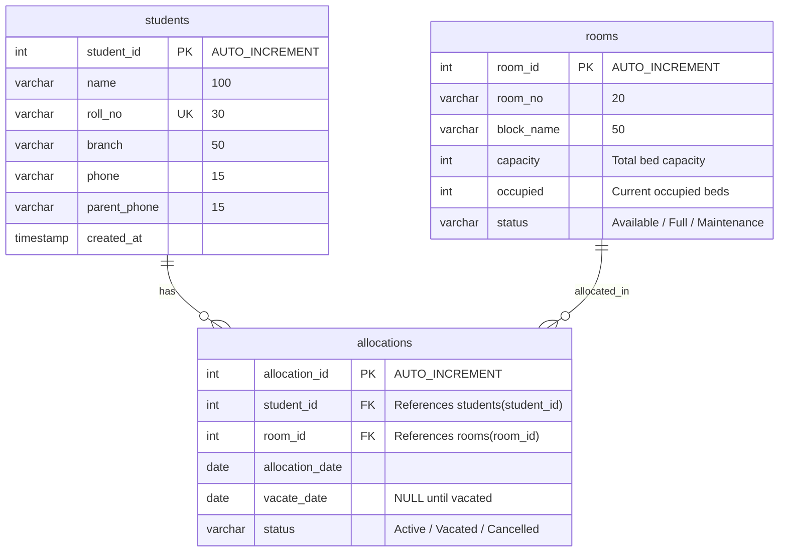

# 🏫 College Hostel Management System (MySQL)

**Project Team:** T11  
**Target Environment:** MySQL 8.0+ / MySQL Workbench  

---

## 📌 Project Overview
The **College Hostel Management System** is a database management project designed to streamline the administration of student hostel accommodation. It enables hostel wardens to:
- Manage student admission details and emergency contact records.
- Monitor room inventory, block allocation, and live bed occupancy.
- Allocate and vacate rooms smoothly while preventing overbooking or duplicate allocations.
- Generate real-time reports on room occupancy and pending student allocations.

---

## 🗄️ Database Architecture & Schema

The system comprises three core relational entities matching the project specifications:



---

## 📋 Table Specifications

### 1. `students` Table
Stores student enrollment details and emergency contact information.
| Field Name | Data Type | Key / Constraint | Description |
| :--- | :--- | :--- | :--- |
| `student_id` | `INT` | Primary Key, `AUTO_INCREMENT` | Unique identifier for each student |
| `name` | `VARCHAR(100)` | `NOT NULL` | Full name of the student |
| `roll_no` | `VARCHAR(30)` | `NOT NULL`, `UNIQUE` | College roll / registration number |
| `branch` | `VARCHAR(50)` | `NOT NULL` | Academic branch (e.g., CSE, ECE, ME) |
| `phone` | `VARCHAR(15)` | `NOT NULL` | Student personal mobile number |
| `parent_phone`| `VARCHAR(15)` | `NOT NULL` | Parent / guardian emergency contact |
| `created_at` | `TIMESTAMP` | `DEFAULT CURRENT_TIMESTAMP` | Record creation timestamp |

### 2. `rooms` Table
Maintains room inventory, bed capacity, and live occupancy across hostel blocks.
| Field Name | Data Type | Key / Constraint | Description |
| :--- | :--- | :--- | :--- |
| `room_id` | `INT` | Primary Key, `AUTO_INCREMENT` | Unique identifier for each room |
| `room_no` | `VARCHAR(20)` | `NOT NULL` | Room number (e.g., A-101, B-201) |
| `block_name`| `VARCHAR(50)` | `NOT NULL` | Hostel block name (e.g., Block A, Block B) |
| `capacity` | `INT` | `CHECK (capacity > 0)` | Maximum bed capacity of the room |
| `occupied` | `INT` | `CHECK (occupied >= 0 AND occupied <= capacity)` | Currently occupied beds |
| `status` | `VARCHAR(20)` | `CHECK IN ('Available', 'Full', 'Maintenance')` | Current room status |

### 3. `allocations` Table
Tracks room assignment history, active stays, and vacate records.
| Field Name | Data Type | Key / Constraint | Description |
| :--- | :--- | :--- | :--- |
| `allocation_id` | `INT` | Primary Key, `AUTO_INCREMENT` | Unique allocation transaction ID |
| `student_id` | `INT` | Foreign Key (`students.student_id`) | Referenced student |
| `room_id` | `INT` | Foreign Key (`rooms.room_id`) | Referenced room |
| `allocation_date`| `DATE` | `DEFAULT (CURRENT_DATE)` | Date room was allocated |
| `vacate_date` | `DATE` | `DEFAULT NULL` | Date student vacated room |
| `status` | `VARCHAR(20)` | `CHECK IN ('Active', 'Vacated', 'Cancelled')` | Status of allocation |

---

## ⚡ Automated Business Logic (Triggers)

1. **`trg_before_allocation_insert` (Safety Validation):**
   - Automatically checks if a student already has an active room allocation. If so, rejects the transaction with an error.
   - Verifies that the target room is not marked for `Maintenance` and is not already full (`occupied >= capacity`).
2. **`trg_after_allocation_insert` (Occupancy Auto-Increment):**
   - Automatically increments the room's `occupied` count when an active allocation is made.
   - Automatically changes room status to `'Full'` once maximum capacity is reached.
3. **`trg_after_allocation_update` (Vacate Management):**
   - When an allocation status is changed to `'Vacated'`, decrements room `occupied` and flips the status back to `'Available'`.
4. **`trg_after_allocation_delete` (Safety Cleanup):**
   - If an allocation record is deleted, safely decrements the room occupancy.

---

## 🛠️ Stored Procedures for Wardens

| Stored Procedure | Parameters | Description |
| :--- | :--- | :--- |
| `sp_allocate_room` | `(student_id, room_id)` | Allocates a room to a student with automated validation. |
| `sp_vacate_room` | `(student_id)` | Vacates a student's active room and stamps today's date on `vacate_date`. |
| `sp_update_student_details` | `(student_id, phone, parent_phone)` | Updates student and parent emergency contact numbers. |
| `sp_get_student_hostel_profile`| `(student_id)` | Fetches a student's complete academic, contact, and room allocation profile. |

---

## 📊 Monitoring Views

- **`vw_active_allocations`:** Displays all currently resident students along with roll number, room number, block, and parent contact.
- **`vw_room_occupancy_report`:** Real-time occupancy monitor showing total capacity, occupied beds, available beds, and occupancy percentage.
- **`vw_available_rooms`:** Instant lookup for rooms with vacant beds ready for new allotments.
- **`vw_unallocated_students`:** Identifies registered students who currently do not have a hostel room assigned.

---

## 🚀 How to Run in MySQL Workbench

### Option A: One-Click Setup (Master Script)
1. Launch **MySQL Workbench** and connect to your local MySQL instance.
2. In the top menu, click **File** ➔ **Open SQL Script...**
3. Select `hostel_management_master.sql`.
4. Click the **Execute (Lightning Bolt ⚡)** button to run the entire script.
5. In the left **Navigator** pane, refresh the **SCHEMAS** tab — you will see `college_hostel_db` with all tables, views, triggers, and procedures ready!

### Option B: Step-by-Step Execution
You can also run the modular scripts in sequence:
1. `01_schema.sql` (Creates Database and 3 Tables)
2. `02_triggers.sql` (Installs business logic triggers)
3. `03_procedures.sql` (Installs warden stored procedures)
4. `04_views.sql` (Installs monitoring views)
5. `05_sample_data.sql` (Populates test students, rooms, and allocations)
6. `06_queries.sql` (Runs demonstration and analytical queries)

---

## 🖼️ Generating the EER Diagram in MySQL Workbench
To view or export the Entity-Relationship diagram for your project submission:
1. In MySQL Workbench, go to menu **Database** ➔ **Reverse Engineer...**
2. Follow the wizard steps and select `college_hostel_db`.
3. Click **Execute** ➔ **Finish**.
4. MySQL Workbench will generate a visual EER Diagram showing all tables, primary keys, and foreign key relations.
5. Go to **File** ➔ **Export** ➔ **Export as PNG / PDF** to save the diagram for your project report.

---

## 📁 Repository Structure
```
college-hostel-management/
├── README.md                     # Comprehensive project documentation
├── hostel_management_master.sql  # All-in-one executable script
├── 01_schema.sql                 # DDL: Tables, constraints, and indexes
├── 02_triggers.sql               # Automation: Capacity & occupancy management
├── 03_procedures.sql             # Warden operations: Allocation, vacating, updates
├── 04_views.sql                  # Reporting: Live occupancy & student status
├── 05_sample_data.sql            # Realistic sample records
└── 06_queries.sql                # Demonstration & analytical queries
```
